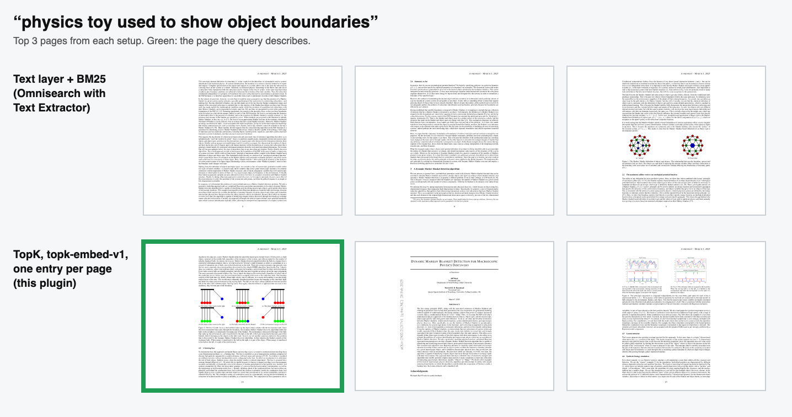

# TopK Visual Search for Obsidian

Find the exact PDF page or image in your vault by describing what it looks like.
Type "slide with the reranker architecture diagram" and get `talk.pdf`, page 15, with a thumbnail.
Click it and Obsidian opens that page.

<!-- Add docs/images/demo.gif (the Stage 1 demo recording), then uncomment:

-->

The plugin uses [TopK](https://topk.io)'s hosted multimodal embeddings (topk-embed-v1), which read
each page as an image. Charts, diagrams, tables, screenshots and scans are searchable without OCR.

> Desktop only, Obsidian 1.11.4 or later. Requires a TopK account and API key. TopK is a paid
> service; new accounts get $10 of free credits. Indexing costs about $0.13 per 1,000 pages, and the
> plugin shows an estimate before uploading.

## How well it finds pages

We ran 100 queries over 35 openly licensed papers and slide decks (1,026 pages) and checked whether
each setup returns the page the query describes. Half the queries are specific; half are vague,
half-remembered descriptions of 3–8 words, such as "physics toy used to show object boundaries".



<!-- benchmark-table:start -->

| Setup                                               | Vague: page found first | Vague: in top 5 | Specific: found first |
| --------------------------------------------------- | ----------------------: | --------------: | --------------------: |
| Text search (Omnisearch with Text Extractor)        |                      4% |             26% |                   40% |
| **TopK Visual Search** (topk-embed-v1, page images) |                 **48%** |         **74%** |               **98%** |

<!-- benchmark-table:end -->

On vague queries, most of TopK's misses land on a neighbouring page of the right document. Its
weakest category is charts described by what they mean rather than how they look. The answers are
drafts written for this benchmark; see [bench/README.md](bench/README.md) for the method and
caveats, and run it yourself with `npm run bench:fetch` and `npm run bench`.

## Install

**With BRAT** (until the plugin is in the community store):

1. In Obsidian, install and enable **BRAT** from Settings → Community plugins → Browse.
2. Command palette → **BRAT: Add a beta plugin for testing**, enter `davidmyriel/obsidian-topk`,
   and pick the latest version.
3. Enable **TopK Visual Search** under Settings → Community plugins.

**By hand:** download `main.js`, `manifest.json` and `styles.css` from the
[latest release](https://github.com/davidmyriel/obsidian-topk/releases/latest) into
`<your vault>/.obsidian/plugins/topk-visual-search/`, then enable the plugin.

## Use

1. Open **Settings → TopK Visual Search**. Add your TopK API key (stored in Obsidian's secret
   storage), pick your region, and click **Test connection**.
2. Run **Index vault** from the command palette. The first time, the plugin shows how many pages it
   will upload and what that costs, and waits for you to confirm. Progress shows in the status bar,
   with a Cancel link.
3. Run **Visual search** (or click the ribbon icon), describe the page, and press Enter. Click a
   result to open the PDF at that page.
4. **Save results as note** writes the results as links to each page.

Describe pages in a few words ("old world map", "bar chart of rainfall by year"): the image model
needs more than one word to rank well. One- and two-word searches also match file names on your
device. Put exact phrases in quotes, or type a code such as `INV-2291`: pages whose text contains
it come first, through TopK's hybrid search of image and text in one query.

After the first index, the plugin keeps the index up to date on its own: a few seconds after you
add, change, rename or delete a PDF or image, and when Obsidian starts. Turn off **Index
automatically** in settings to do it by hand. Only files whose content changed are uploaded again.
Renaming or moving files costs nothing, because pages are identified by a hash of the file content.
Tall images such as long screenshots are split into page-sized tiles.

Other commands: **Show index status** (what's indexed, skipped or failed, with Retry), **Rebuild
index** (re-uploads everything with the current settings), **Remove my data from TopK**, and
**Clear local index**.

Indexed file types: PDF, PNG, JPEG and WebP.

## Network use and privacy

The plugin connects only to the TopK endpoint for your region. It uploads an image of each page,
and the text layer of each PDF page, which TopK stores in your collection so they can be searched,
and the text of your queries. Images are
redrawn before upload, so photo metadata such as GPS location is not sent. File names and folder
paths never leave your device. There is no telemetry. See [docs/PRIVACY.md](docs/PRIVACY.md).

Run **Remove my data from TopK** before uninstalling: the id that finds this vault's pages lives in
the plugin folder, which uninstalling deletes.

Because page images are stored with a cloud service, don't index documents you are not allowed to
share with one: client or patient records, or material under NDA. Use **Exclude patterns** to keep
such folders out.

## Develop

```bash
npm ci
npm run build
```

| Command               | What it does                                                                     |
| --------------------- | -------------------------------------------------------------------------------- |
| `npm run dev`         | Rebuilds `main.js` on change                                                     |
| `npm run check`       | Lint, typecheck, unit, integration and contract tests, build                     |
| `npm run test:e2e`    | Boots real Obsidian (minimum and latest) with the fixture vault and a mock TopK  |
| `npm run test:live`   | Indexes the fixture vault into a throwaway TopK collection; needs `TOPK_API_KEY` |
| `npm run bench:fetch` | Downloads the benchmark corpus                                                   |
| `npm run bench`       | Runs the benchmark; see [bench/README.md](bench/README.md)                       |

Design notes are in [docs/ARCHITECTURE.md](docs/ARCHITECTURE.md) and the decisions in
[docs/adr](docs/adr).

## License

[MIT](LICENSE)
