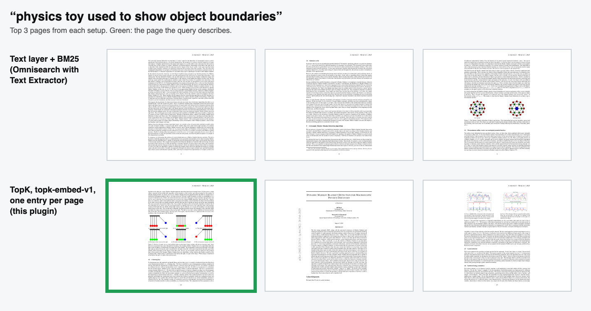

# Find the figure, not the 140 papers that mention it

_Draft for review. Numbers marked **[Gemini]** are filled in once the Gemini Embedding 2 runs
finish. Nothing here is published until Dave approves it._

You remember the slide. It had the two-stage retrieval diagram, the one with the reranker in the
middle. You type "reranker" into Obsidian's search and get every paper that mentions reranking,
but not the slide, because the slide's only text is "Stage 1" and "Stage 2" inside a diagram.

TopK Visual Search is an Obsidian plugin that searches your PDFs and images by what is on the
page. Describe the page and it returns the page: the PDF, the page number and a thumbnail. Click
it and Obsidian opens that page.

## How it works

Each PDF page and image in your vault is uploaded as an image to your own
[TopK](https://topk.io) collection. TopK embeds it with topk-embed-v1, a multi-vector model that
reads the page the way you see it, layout, figures and all, instead of extracting its text first.
When you search, your words are matched against every page with late interaction (MaxSim), and the
best pages come back with thumbnails.

The plugin keeps the index current as your vault changes. Renames are free, because pages are
identified by a hash of their content. Deletes remove the pages from TopK, and an interrupted index
resumes where it stopped. File names and folder paths never leave your device. Before the first
upload it tells you how many pages it will send and what that costs: about $0.13 per 1,000 pages,
and new TopK accounts get $10 of credits.

## Does it actually find pages?

We built a small, reproducible benchmark: 35 openly licensed arXiv papers and conference slide
decks, 1,026 pages in all, and 100 queries. Each query targets one page. There are 12 diagrams,
12 charts, 10 tables, 6 screenshots and 10 plain-text passages as a control, and each target has
two queries:

- a **specific** one written while looking at the page ("violin plot of how many blobs different
  GPT vision models counted in an image"), and
- a **vague** one, the way you half-remember a page a month later ("testing chatbots on counting
  things in images").

We compared four setups:

| Setup                                             | Vague: found first | Vague: top 5 | Specific: found first |
| ------------------------------------------------- | -----------------: | -----------: | --------------------: |
| Text search (what Omnisearch + Text Extractor do) |                 4% |          26% |                   40% |
| Gemini Embedding 2, 6-page chunks (LLM Hub)       |       **[Gemini]** | **[Gemini]** |          **[Gemini]** |
| Gemini Embedding 2, 1-page chunks                 |       **[Gemini]** | **[Gemini]** |          **[Gemini]** |
| **TopK Visual Search**                            |            **48%** |      **74%** |               **98%** |

What the numbers say:

- **Text search can't see pictures.** It found 25% of specific chart queries and none of the
  screenshot queries first. Its best category was plain text, which is exactly what it is for.
- **Vague queries are the real test.** Specific queries are easy for an image model: TopK found
  98% of them first. Vague ones are harder, and TopK found 48% first and 74% in the top 5. Most of
  its misses land on a neighbouring page of the right document.
- **Charts are the weak spot.** A vague chart query describes what the chart means ("is the Python
  version slower"), not what it looks like. TopK usually finds the right deck but picks a nearby
  slide whose text matches better. Image embeddings read the words on a chart better than its
  meaning.

**[Gemini]:** one paragraph comparing against Gemini Embedding 2, written once the numbers are in.
If Gemini is close, the message is "as good, with no chunking to tune and page-level results". If
it is far behind, say so plainly.

### Caveats

We would rather you trust these numbers than be impressed by them:

- The queries and answers were written by one author who knew which systems were being tested.
  They have not yet been labelled independently by two people.
- A vague query can fit more than one page; only the original target counts. These scores are a
  lower bound.
- The corpus is born-digital PDFs with clean text layers, the text baseline's best case. Scans,
  handwriting and whiteboard photos are not in it yet.
- 50 queries per tier means wide error bars, roughly ±13 percentage points.

Everything is in the repository: the corpus manifest with sources and licences, the queries, and
the runners. `npm run bench:fetch && npm run bench` reproduces the table.

## Try it

The plugin is free and open source (MIT) and installs through BRAT while it waits for the
community store: [github.com/davidmyriel/obsidian-topk](https://github.com/davidmyriel/obsidian-topk).
You need a TopK API key; new accounts get $10 of credits, enough for tens of thousands of pages.

Don't index what you can't share with a cloud service: client or patient records, or material under
NDA. Folder include and exclude settings keep those out.

## Build it into your own product

The plugin is a small layer over the TopK API: upload page images with `image()` and
`semantic_index()`, then query with a text string. If you have a document search feature of your
own, the same page-level search is a few API calls away. **[link to the TopK docs or tutorial]**
